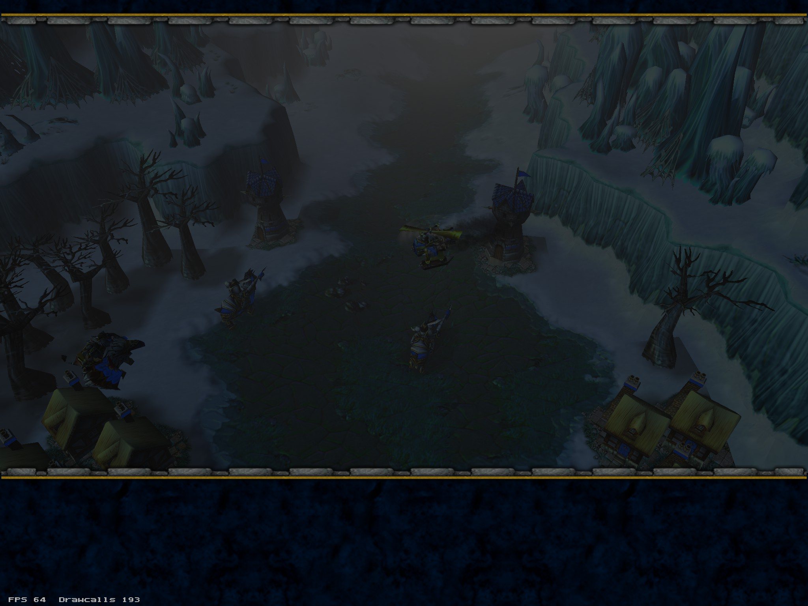
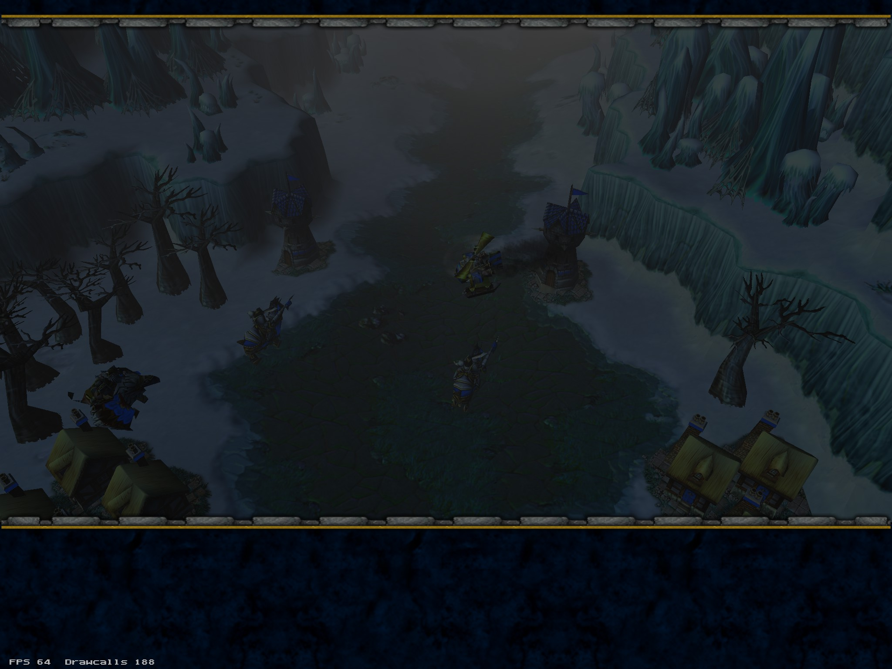

# Ground Shadow Borders: Issue 684 Investigation

## Status and visual evidence

Investigation on 2026-11-05 against `6b4a2b4db21c62f971144e59963673c683b09dad`.
[Issue 684](https://github.com/corepunch/open-realm/issues/684) was open with no comments at inspection.
The follow-up on the same day reproduced the artifacts in the local Human09 intro and measured the source/GPU alpha.
This remains an investigation record, **not a verified fix or established retail border contract**.

The issue's [retail capture](https://github.com/user-attachments/assets/e1e50b51-8f61-4727-b016-a134b6b6f7c4)
shows soft transitions around the foreground bare trees and the tower above them.
The [Open Realm capture](https://github.com/user-attachments/assets/322dbcf8-e4cc-48fc-b4aa-9fab1004e1c5)
shows straight rectangular shadow boundaries below the foreground trees, behind the tower, and near the upper-right trees.
These are different camera positions, resolutions, and simulation times; they cannot establish a quantitative opacity difference.
Snow makes the boundary conspicuous, but is not evidence that snow requires different shadow opacity.

## Source trace

| Path | Source and placement | Opacity and composition |
| --- | --- | --- |
| Authored terrain shadow | `w3m/r_war3map.c:R_FileReadShadowMap` reads `(width-1)*4` by `(height-1)*4` bytes from `war3map.shd`; `_W3M_DrawTerrainShadows` submits a whole-map rectangle | Black RGBA, alpha `sample/2`, white alpha 255 vertex multiplier |
| Destructable shadow | `game/g_spawn.c` loads the row's `shadow` via `G_LoadShadowTexture`; sets `shadow_rect=0` | Entity path below |
| Building shadow | `game/g_monster.c:M_SetBuildingShadow` loads `buildingShadowTexture`; sets `shadow_rect=0` | Entity path below |
| Entity splat | `renderer/r_ents.c:R_DrawEntityShadow`; `R_RenderShadow` in WC3 returns false, so the generic decal path owns this draw | Black RGB; texture alpha multiplied by vertex alpha 128 |

Paths without a leading directory above are relative to `games/warcraft-3/`.
`G_LoadShadowTexture` resolves `ReplaceableTextures\\Shadows\\<name>.blp`; optional DDS fallback is enabled for units,
but disabled for the destructable/building calls above. `client/cl_view.c` passes the registered texture and unpacked rectangle
to the renderer. With no explicit rectangle, footprint width and height are texture dimensions times 32 world units;
pivots are rounded `width*0.3` and `height*0.7`. Padding would therefore affect placement as well as filtering if added naively.

Both paths use `sd_shadow_splat` in `renderer/r_shader.c`. `R_SetupSplatState` in
`w3m/r_war3map_ground.c` selects `GL_SRC_ALPHA, GL_ONE_MINUS_SRC_ALPHA`, disables depth writes,
and enables polygon offset. The shader uses sampled alpha, not texture RGB or terrain lighting.
Underlying terrain lighting still affects the final blended colour. Fog changes the shadow RGB contribution as described in
[environmental fog](environmental-fog.md#ground-shadow-composition); it does not create a soft spatial border.

## What the padding hypothesis explains

Confirmed from source:

- `R_LoadTextureBLP1Named` uploads every mip at its authored width and height. The decoder traverses all pixels;
  there is no last-row/last-column trim. `R_LoadTextureMipLevel` passes those same dimensions to `glTexImage2D`.
- `R_AddRectSplat` supplies UV bounds `(0,0)..(1,1)`. `R_EmitSplatTile` uses the complete rectangle and flips V;
  it does not skip an existing empty row. Both the cached and uncached paths use this rectangle contract.
- Splats select `GL_CLAMP_TO_EDGE`. Uploads select linear magnification and either linear or trilinear minification.
- Geometry is clipped to the rectangle; the shadow fragment shader also applies a hard `crop_edges` step at UV 0/1.
  No transparent padding is synthesized.

Thus a nonzero alpha at a texture boundary remains nonzero up to the clipped geometry edge, and stops abruptly there.
Linear filtering with `CLAMP_TO_EDGE` cannot interpolate into nonexistent transparent texels.
Existing transparent rows would be retained and sampled. Which source edge appears at the bottom of the world rectangle
must account for the V flip; do not assume image-bottom and world-bottom are the same edge.

## Measured assets and runtime isolation

Local RoC data resolves `NTtw`, `WTtw`, and `WTst` through `Units/DestructableData.slk` to
`BuildingShadowSmall`; `YTct`, `YTwt`, and `YTst` instead name `ShadowCityTree`. There is no
`NorthrendTree.blp` shadow asset: the model name is not the shadow lookup key.

The following files were read from the installed `War3.mpq`, under `ReplaceableTextures/Shadows/`.
All five are BLP1 direct-paletted images with 8-bit separated alpha and **one mip only**.
The archive's executable version has not been established; these are measurements of the local data, not all editions.
Values are inclusive minimum–maximum alpha in source image order, before the splat V flip.

| File | Dimensions | Top | Bottom | Left | Right |
| --- | --- | --- | --- | --- | --- |
| `BuildingShadowSmall.blp` | 9 × 9 | 0 | 0 | 0 | 0 |
| `ShadowCityTree.blp` | 9 × 9 | 0 | 0 | 0 | 0 |
| `ShadowGuardTower.blp` | 9 × 9 | 0–255 | 0 | 0 | 0–255 |
| `ShadowCannonTower.blp` | 9 × 9 | 0 | 0 | 0 | 0 |
| `Shadow.blp` | 64 × 64 | 0 | 0 | 0 | 0 |

`BuildingShadowSmall` has only 0/255 source alpha. Its inner row next to the bottom border is
`0 0 0 255 255 255 0 0 0`; the outside row is entirely zero. The tower differs: its top row is
`0 0 0 0 0 0 255 255 0`, and its right column is `0 255 255 255 0 0 0 0 0`.
The two files' SHA-256 values are:

```text
BuildingShadowSmall.blp 43fe15d3375d1f38ba04dee2e2300dd1b6ce7c097081d0da30344f82bd31f6f8
ShadowGuardTower.blp    120de0496e3c89211e600bdbe320c353d9e4fc05f5075982c6261787f552d87b
```

Temporary desktop GL probes read back the complete 9 × 9 GPU images for those two textures, with the same alpha
as the source planes. At setup, the actual sampler was unit 0 and the expected texture was bound. Draw-time probes
confirmed blending enabled, `GL_FUNC_ADD`, `GL_SRC_ALPHA`, and `GL_ONE_MINUS_SRC_ALPHA`. A temporary grayscale
shadow shader also displayed the sampled masks. All probes and shader changes were removed.

The local Human09 intro reproduces visible straight cutoffs without a progressed save. A paused camera comparison
with `r_unit_shadows` switched between captures removes the suspect shadows with the entity pass disabled:





These captures isolate the entity contribution. MDX animation and the FPS counter still advance while simulation is paused,
so do not treat every changed pixel as a shadow. They are not matched retail captures, daylight comparisons, or a fix.

The measurements rule out a universally missing or trimmed transparent source row for the measured tree textures.
The guard-tower edge alpha can explain a hard boundary for that texture; it does **not** establish the cause of every tree cutoff.
The remaining questions are the affected fragment's UV/sample at the visible tree boundary, overlapping shadow composition,
and retail's treatment of these low-resolution masks. Adding a generic border or reducing opacity is not yet justified.

## Repeating the measurements

Inspect the header and extract one small source asset with existing tools:

```sh
build/bin/mpqtool -mpq 'data/Warcraft III/War3.mpq' imginfo ReplaceableTextures/Shadows/BuildingShadowSmall.blp
build/bin/mpqtool -mpq 'data/Warcraft III/War3.mpq' cat ReplaceableTextures/Shadows/BuildingShadowSmall.blp > /tmp/BuildingShadowSmall.blp
```

For this confirmed BLP1/paletted/8-bit-alpha layout, the alpha plane follows `width*height` index bytes at each mip offset.
This bounded script prints every stored mip's four edges; reject other formats rather than interpreting their bytes this way:

```sh
python3 - <<'PYALPHA'
import struct
from pathlib import Path
blob = Path('/tmp/BuildingShadowSmall.blp').read_bytes()
header = struct.unpack_from('<39I', blob)
assert blob[:4] == b'BLP1' and header[1:3] == (1, 8)
for level, offset in enumerate(header[7:23]):
    if not offset:
        continue
    width, height = header[3] >> level, header[4] >> level
    assert width > 0 and height > 0
    alpha = blob[offset + width*height:offset + 2*width*height]
    assert len(alpha) == width*height
    edges = (alpha[:width], alpha[-width:], alpha[::width], alpha[width-1::width])
    print(level, width, height, [(min(edge), max(edge)) for edge in edges])
PYALPHA
```

## Completing the reproduction

1. Use the reported scene (the Human09 campaign scene is suggested by the ship countdown, but the exact map/save
   was not supplied in the issue text). Record archive edition, map/save, camera, time, and resolved tree/building shadow paths.
2. Capture identical frozen scene state with `r_unit_shadows 1` and `0`. This isolates entity splats, **not** the authored
   terrain shadow helper. If needed, temporarily suppress `_W3M_DrawTerrainShadows` independently in a diagnostic build.
   Do not infer source ownership solely from a shadow's proximity to a tree.
3. Inspect decoded alpha on all four sides of every mip of the resolved textures, plus adjacent inner rows/columns.
   Compare the decoded dimensions with BLP metadata and GPU uploads. Check archive overrides and missing-texture logs.
4. Only if boundary alpha explains the cutoff, compare an experimental transparent-border/expanded-footprint implementation
   with retail, preserving texel-to-world scale and pivot. Inspect both outer coverage and overlapping shadow opacity.
5. Capture snow and ordinary grass/dirt with identical lighting and fog, including fog disabled, partial fog, overlapping
   shadows, unit explicit rectangles, and existing transparent-border textures. Preserve interior alpha and normal footprints.

Use bounded engine captures after restoring the scene; the issue attachments are references, not new runtime validation:

```sh
build/bin/openwarcraft3 -data 'data/Warcraft III' -roc +vid_hidden 1 +set r_unit_shadows 1 +map Maps/Campaign/Human09.w3m +screenshot 90 +com_frame_limit 120
build/bin/openwarcraft3 -data 'data/Warcraft III' -roc +vid_hidden 1 +set r_unit_shadows 0 +map Maps/Campaign/Human09.w3m +screenshot 90 +com_frame_limit 120
```

The commands alone do not restore the attachment's progressed gameplay state. Confirm the map and reproduce that state
before treating the output as a comparison. Restore `r_unit_shadows 1` afterward.

## Verification and limits

The first investigation could not build because its environment lacked SDL2 headers or inspect assets because it lacked retail data.
The local follow-up has both. `make BUILD=release -j4 build` built the WC3 binary and all three renderer libraries without compiler
warnings. `make BUILD=release TEST_JOBS=4 test` passed, including RoC/TFT fixture suites. Restricted execution initially denied
loopback sockets; rerunning with local socket access passed. The two renderer suites also passed independently.

Three new tests preserve the measured pipeline contracts without depending on installed archives:

- `renderer_texture.blp1_preserves_shadow_borders_and_all_mip_texels`: synthetic 9 × 9 and non-square 16 × 8 BLP1 fixtures;
  zero and nonzero outer pixels; every texel of four mips; native BGRA and converted RGBA uploads. Captures the production
  decoder's `glTexImage2D` handoff, including dimensions and levels.
- `renderer_terrain.shadow_rect_submission_keeps_full_uv_border_on_cache_hit`: submits through `R_BeginSplatBatch` /
  `R_AddRectSplat` / `R_EndSplatBatch`; verifies the V flip, all four UV boundaries, alpha 128, and cold/baked/cached geometry.
- `renderer_game.shadow_footprint_keeps_source_texel_scale_pivot_and_explicit_rect`: drives `R_DrawEntityShadow` and checks
  non-square 32-unit texel placement, rounded pivots, and the independent explicit unit rectangle.

These are passing contract tests, not a failing reproducer of the visible defect. They prevent a later proposed correction from
silently trimming source data or changing placement. A rendering correction still needs a failing observable regression and
snow/grass framebuffer comparisons, including fog on/off and overlapping shadows. No production rendering behavior, opacity,
network wire format, or save format has changed.
