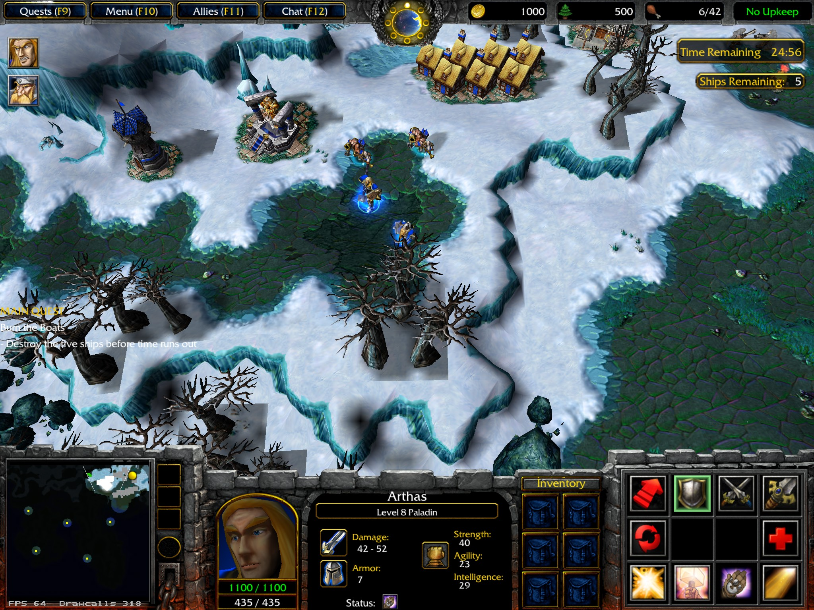
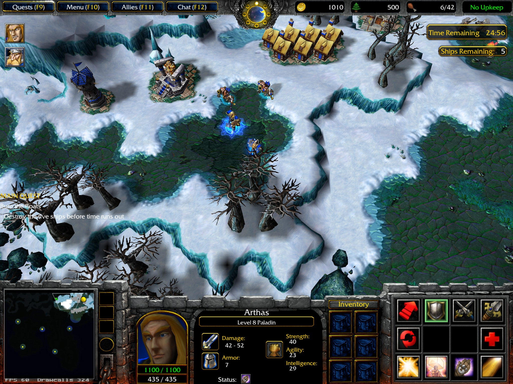

# Ground Shadow Cutoffs

## Result and visual evidence

[Issue 684](https://github.com/corepunch/open-realm/issues/684) exposed two independent defects:
entity shadows omitted cliff-owned terrain cells, and opaque texture-border texels were cropped without a transparent
filtering border. Both are corrected by [PR 689](https://github.com/corepunch/open-realm/pull/689).
Snow makes the cutoffs conspicuous; the correction does not depend on terrain colour or reduce overall shadow opacity.

The reported scene is **Human08, Chapter Eight: Dissension**. Its `war3map.wts` contains both `Ships Remaining:` and
`Time Remaining`; Human09 is `Chapter Nine: Frostmourne`. The paired local captures below use Human08's camp camera
at `(4373, 3695)`, after stopping the intro and allowing the black fade to finish. The baseline renderer is from
`af888d804e2982539ba45698701831732bb0fb67`; the second capture includes the correction.

Before:



After:



The foreground and upper-right tree cutoffs disappear, and the guard tower's outside edge fades into the snow.
The two runs have the same camera and countdown, but unit animation, the resource tick, and the FPS counter can differ.
These are local before/after captures, not a pixel-matched retail comparison.
Earlier [entity-enabled](../../images/shadow-borders-human08-entities.jpg) and
[entity-disabled](../../images/shadow-borders-human08-no-entities.jpg) intro captures isolate the entity pass.

## Root causes

### Missing cliff receivers

`R_GenerateSplatTiles` accepted only cells with base ground. `R_TileHasGround` correctly rejects cells whose terrain is
replaced by a cliff/ramp mesh, but the splat generator never submitted those replacement triangles. A cliff mesh includes
flat footing and upper terrain as well as vertical walls, so a shadow could stop on apparently flat snow a full cell
before the visible wall.

Live GPU readback confirmed the tree mask still had its transparent outer rows. Replaying the submitted vertices on a
white background reproduced the cutoff inside the texture: affected triangles stopped around U `0.5556` or V `0.4444`,
not at the transparent texture edge. Disabling depth testing did not restore the missing coverage. This rules out a
trimmed texture row, terrain lighting, and later draw passes as the cause of these tree cutoffs.

`R_FinishCliffs` now retains final baked triangle positions and exact per-layer bounds. The splat generator clips those
triangles in XY against the shadow rectangle and each cliff-owned cell, preserving authored Z and original UV mapping.
It excludes ordinary ground cells to avoid applying alpha twice where a cliff mesh spills across their boundary.
No interpolated base quad is substituted for a vertical wall or raised shelf.

The CPU copy costs 12 bytes per cliff vertex, is freed with its map layer, and is rebuilt through the existing terrain
rebuild lifecycle. Existing cache invalidation covers deformation and map changes. Bounds reject unrelated layers;
stationary splats reuse the same bounded geometry cache as base-ground splats. A mesh that exceeds the cache budget
falls back to streamed batches without dropping triangles. Allocation failure logs a warning and retains ordinary cliff
rendering, while that layer cannot receive splats.

### Opaque source borders

`ShadowGuardTower.blp` has nonzero outer alpha. `GL_CLAMP_TO_EDGE` repeats those outer texels, and the old geometry plus
shader `crop_edges` stopped abruptly at UV 0/1. Linear filtering alone cannot fade into nonexistent transparent texels.
The measured tree masks already have transparent borders, so this second defect does not explain their missing cells.

The WC3 entity-shadow shader now samples the unchanged source texture and multiplies alpha by a virtual transparent
border:

```glsl
vec2 edge = clamp(min(uv, vec2(1.0) - uv) * textureSize + vec2(0.5), 0.0, 1.0);
alpha *= edge.x * edge.y;
```

The producer expands geometry and UVs by half a source texel on all four sides. Original texel centres, source scale,
pivot, and explicit unit rectangles stay fixed. Opaque edge texels fade outward; already transparent borders remain
transparent. Interior texture alpha is still multiplied by vertex alpha 128, with the existing blend function.
The source assets and their mip levels are not rewritten.

## Ownership and composition

`R_DrawEntityShadow` computes the authored source footprint once and passes it to the per-game `R_RenderShadow` hook.
With no explicit rectangle, dimensions are texture dimensions times 32 world units, with rounded pivots `width*0.3`
and `height*0.7`. WC3 owns the filtering expansion and shader. WoW and SC2 retain their existing shadow behavior.
This is an internal renderer contract; no client export, network, or save format changes.

`G_LoadShadowTexture` resolves `ReplaceableTextures\\Shadows\\<name>.blp`. Destructables use the SLK `shadow` row;
buildings use `buildingShadowTexture`. The universal client transports the texture and rectangle unchanged.
WC3's descriptor derives from `sd_shadow_splat`, adds source dimensions, and uses the shared `BZ_SCENE_FOG_GLSL`
equation from `renderer/r_shader.h`. It is created lazily and released at renderer shutdown.

`R_SetupSplatState` retains `GL_SRC_ALPHA, GL_ONE_MINUS_SRC_ALPHA`, disables depth writes, and enables polygon offset.
The separate `war3map.shd` terrain helper retains the shared shader and its sample/2 alpha. Both paths can now receive
on cliff geometry. Fog-aware RGB composition remains as described in [environmental fog](environmental-fog.md#ground-shadow-composition).

## Measured assets

Local RoC data resolves `NTtw`, `WTtw`, and `WTst` through `Units/DestructableData.slk` to
`BuildingShadowSmall`; `YTct`, `YTwt`, and `YTst` instead name `ShadowCityTree`. There is no
`NorthrendTree.blp` shadow asset: the model name is not the shadow lookup key.

The following files were read from the installed `War3.mpq`, under `ReplaceableTextures/Shadows/`.
All five are BLP1 direct-paletted images with 8-bit separated alpha and **one mip only**.
The archive's executable version has not been established; these are measurements of the local data, not all editions.
Values are inclusive minimum–maximum alpha in source image order, before the splat V flip.

| File | Dimensions | Top | Bottom | Left | Right |
| --- | --- | --- | --- | --- | --- |
| `BuildingShadowSmall.blp` | 9 × 9 | 0 | 0 | 0 | 0 |
| `ShadowCityTree.blp` | 9 × 9 | 0 | 0 | 0 | 0 |
| `ShadowGuardTower.blp` | 9 × 9 | 0–255 | 0 | 0 | 0–255 |
| `ShadowCannonTower.blp` | 9 × 9 | 0 | 0 | 0 | 0 |
| `Shadow.blp` | 64 × 64 | 0 | 0 | 0 | 0 |

`BuildingShadowSmall` has only 0/255 source alpha. Its inner row next to the bottom border is
`0 0 0 255 255 255 0 0 0`; the outside row is entirely zero. The tower differs: its top row is
`0 0 0 0 0 0 255 255 0`, and its right column is `0 255 255 255 0 0 0 0 0`.
The two files' SHA-256 values are:

```text
BuildingShadowSmall.blp 43fe15d3375d1f38ba04dee2e2300dd1b6ce7c097081d0da30344f82bd31f6f8
ShadowGuardTower.blp    120de0496e3c89211e600bdbe320c353d9e4fc05f5075982c6261787f552d87b
```

GPU readbacks matched the source alpha and dimensions. Draw-time probes confirmed sampler unit 0, the expected texture,
`GL_FUNC_ADD`, and normal alpha blending. Temporary probes and replay instrumentation were removed from production.
The installed archive's executable edition was not established; these measurements do not claim an identical border
contract for every retail edition.

## Reproduction

Use the installed RoC data and generate a config with the exact frame waits:

```sh
python3 - <<'PYCFG'
from pathlib import Path
lines = ['camera edge 0'] + ['wait'] * 80 + ['cinematic stop']
lines += ['wait'] * 250 + ['camera move 4373 3695'] + ['wait'] * 20
lines += ['pause 1'] + ['wait'] * 4 + ['screenshot']
Path('build/share/warcraft-3/shadow-check.cfg').write_text('\n'.join(lines) + '\n')
PYCFG
```

```sh
build/bin/openwarcraft3 -data 'data/Warcraft III' -roc +vid_hidden 1 +set sv_cheats 1 +set r_unit_shadows 1 +map Maps/Campaign/Human08.w3m +exec shadow-check.cfg +com_frame_limit 390
```

Camera coordinates must be integers. To isolate entity contribution, wait two frames after the first capture,
set `r_unit_shadows 0`, capture again, and restore `r_unit_shadows 1`. Pausing before the intro fade finishes produces a
black frame and is not a useful comparison. The issue attachment's exact progressed save was not available.

### Repeat source measurements

Inspect the header and extract one small source asset with existing tools:

```sh
build/bin/mpqtool -mpq 'data/Warcraft III/War3.mpq' imginfo ReplaceableTextures/Shadows/BuildingShadowSmall.blp
build/bin/mpqtool -mpq 'data/Warcraft III/War3.mpq' cat ReplaceableTextures/Shadows/BuildingShadowSmall.blp > /tmp/BuildingShadowSmall.blp
```

For this confirmed BLP1/paletted/8-bit-alpha layout, the alpha plane follows `width*height` index bytes at each mip offset.
This bounded script prints every stored mip's four edges; reject other formats rather than interpreting their bytes this way:

```sh
python3 - <<'PYALPHA'
import struct
from pathlib import Path
blob = Path('/tmp/BuildingShadowSmall.blp').read_bytes()
header = struct.unpack_from('<39I', blob)
assert blob[:4] == b'BLP1' and header[1:3] == (1, 8)
for level, offset in enumerate(header[7:23]):
    if not offset:
        continue
    width, height = header[3] >> level, header[4] >> level
    assert width > 0 and height > 0
    alpha = blob[offset + width*height:offset + 2*width*height]
    assert len(alpha) == width*height
    edges = (alpha[:width], alpha[-width:], alpha[::width], alpha[width-1::width])
    print(level, width, height, [(min(edge), max(edge)) for edge in edges])
PYALPHA
```

## Regression coverage and verification

The missing-receiver regression failed nine assertions before the geometry fix. It now verifies continuous UVs through
base ground, an overlapping cliff footing, a vertical wall, and a raised shelf, including cold/baked/cached submissions.
Summed projected area detects duplicate alpha coverage in ordinary cells. A 7,776-vertex receiver separately checks
cache overflow and streamed batch flushing. Allocation-failure and map-layer cleanup paths are covered.

The opt-in driver test failed 18 of 100 original pixel assertions before the filtering fix. Its expanded matrix now passes
**562/562 assertions**, using production shaders and framebuffer readback on snow, grass, and dirt colours, fog on/off,
one/two overlapping shadows, opaque/transparent source borders, and cold/cached geometry. It checks the soft edge,
unchanged interior opacity, and untouched transparent border. It uses synthetic textures and requires an available GL
display; it is deliberately separate from the default headless suite and reports failure if a context cannot be created.

```sh
make BUILD=release test-renderer-shadow-pixels
```

Additional tests preserve every authored BLP mip texel for BGRA/RGBA upload, non-square footprint/pivot and explicit
rectangle mapping, shader dimension/fog refresh, shutdown/reinitialization, and cliff receiver bounds/lifetime.

Validation on macOS desktop OpenGL:

- `make BUILD=release -j4 build`: WC3 binary and all three game renderer libraries built without compiler warnings.
- `make BUILD=release TEST_JOBS=4 test`: complete suite passed, including RoC/TFT fixtures.
- `make BUILD=release -j4 test-renderer-model test-renderer-shadows`: both focused suites passed.
- `make BUILD=release test-renderer-shadow-pixels`: framebuffer matrix passed.
- `python3 tools/engine_boundary_audit.py --base origin/main`: clean.
- Human08 camp before/after captures above verify the reported tree and guard-tower defects in the running game.

The correction addresses the demonstrated cutoffs. It does not claim bit-for-bit retail opacity or GPU coverage on
platforms that were not run; the source and shader contracts remain covered by the existing portable renderer tests.
